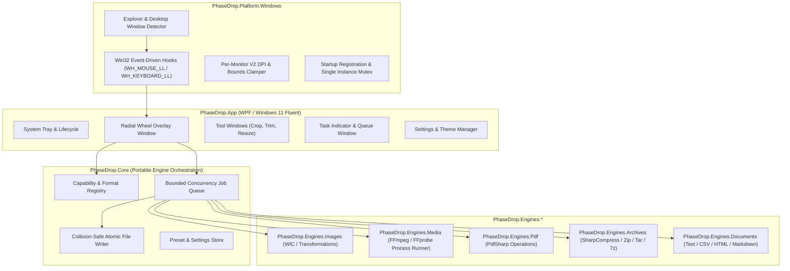
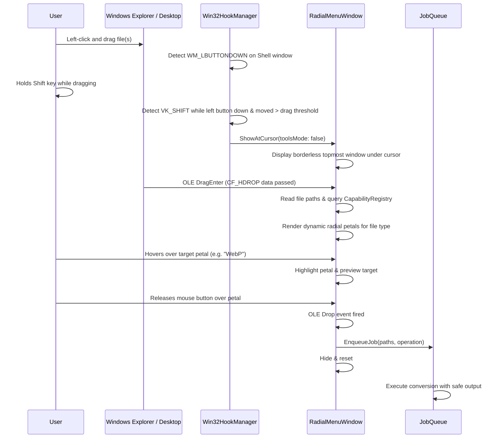

# Phase Drop Architecture Document

## 1. Architectural Principles
Phase Drop is built around four uncompromising design tenets:
1. **Separation of Concerns:** The processing core (`PhaseDrop.Core`) and conversion engines (`PhaseDrop.Engines.*`) remain purely portable .NET 10 libraries, independent of WPF or Windows-specific desktop constructs.
2. **Event-Driven & Zero-Idle-Cost:** No continuous polling loops. Input detection uses lightweight, reactive Win32 low-level hooks that pass unrelated events in microseconds and execute 0 operations while idle.
3. **Data Integrity & Non-Destructive Workflow:** Original files are strictly read-only. Outputs are written using collision-safe naming (`filename (1).ext`), temporary atomic writes, and immediate cleanup on cancellation.
4. **Offline & Self-Contained:** 100% on-device processing. Zero network requests, zero telemetry, zero Python dependencies, and bundled redistributable media engines.

---

## 2. High-Level System Architecture

---

## 3. Project Breakdown

### `PhaseDrop.Core`
* **`Models/`**: `ConversionJob`, `JobProgress`, `FileOperation`, `OperationCategory`, `JobResult`.
* **`Registry/`**: `CapabilityRegistry` — central registry cataloging all supported formats, allowed conversion routes, and contextual tools.
* **`Queue/`**: `JobQueue`, `JobRunner` — bounded concurrency worker channel (`System.Threading.Channels`) with pause, resume, and cancellation support.
* **`IO/`**: `CollisionSafeWriter`, `TempManager` — guarantees safe output file generation and path traversal validation.
* **`Configuration/`**: `UserSettings` — JSON-persisted user preferences in `%LOCALAPPDATA%\PhaseDrop\settings.json`.

### `PhaseDrop.Platform.Windows`
* **`Native/`**: Win32 P/Invoke declarations (`user32.dll`, `dwmapi.dll`, `shell32.dll`).
* **`Hooks/`**: `Win32HookManager` — installs thread-safe low-level hooks only for active drag detection; unhooks cleanly on exit.
* **`Shell/`**: `ShellWindowDetector` — identifies Explorer windows (`CabinetWClass`), desktop (`Progman`, `WorkerW`), and active drag states.
* **`Display/`**: `MonitorBoundsHelper` — clamps the radial wheel within visible screen bounds across multiple monitors and variable scaling factors.
* **`SingleInstance/`**: Named Mutex and inter-process event signaling for single-instance enforcement and argument forwarding.

### `PhaseDrop.Engines.*`
* **`PhaseDrop.Engines.Images`**: Pure managed image processing via Windows Imaging Component (WIC), supporting crop, resize, rotate, flip, format re-encoding, and EXIF stripping.
* **`PhaseDrop.Engines.Media`**: Process execution wrapper for `ffmpeg.exe` and `ffprobe.exe` with strict argument quotation, JSON probe parsing, progress parsing from stderr, and process tree termination.
* **`PhaseDrop.Engines.Pdf`**: Operations including PDF merge, split, page extraction, page rotation, image-to-PDF, and metadata removal.
* **`PhaseDrop.Engines.Archives`**: Archive creation, safe extraction, and format transcoding across ZIP, 7Z, TAR, and GZ with directory traversal checks.
* **`PhaseDrop.Engines.Documents`**: CSV, JSON, TXT, HTML conversions and document export bridges.

### `PhaseDrop.App`
* **`Views/`**:
  - `RadialMenuWindow.xaml`: The Fluent radial menu with animated segments, icons, hover feedback, and category wheel.
  - `CropWindow.xaml`: Interactive image crop tool with draggable crop handles and aspect ratio constraints.
  - `TrimWindow.xaml`: Media trimming and preview window.
  - `TaskIndicatorWindow.xaml`: Non-intrusive floating progress bar and job queue manager.
  - `SettingsWindow.xaml`: App preferences, theme switcher (System/Light/Dark), startup toggle, and about page.
* **`Theme/`**: Fluent design system brushes, DWM backdrop integration (Mica / Acrylic where supported, with crisp dark/light fallback).

---

## 4. OLE Drag-and-Drop Interaction Lifecycle

---

## 5. Security & Isolation Boundaries
1. **No Shell String Concatenation:** Process execution in `MediaEngine` strictly uses `ProcessStartInfo.ArgumentList` to eliminate command injection vulnerabilities.
2. **Archive Slip Prevention:** Archive extraction tests every relative entry path against canonical target directory roots before extraction.
3. **No Unauthenticated Remote Downloads:** The application does not fetch or execute code from external sources.
4. **Non-Elevated Execution:** Phase Drop operates with standard user privileges and writes exclusively to user-selected folders or `%LOCALAPPDATA%\PhaseDrop`.
